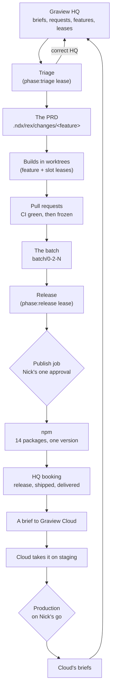

# How Graview is built and released

One page for the whole loop, for people and agents alike: where an ask comes
from, how it becomes a build, which gates it passes, and how it reaches npm
and Graview Cloud. The rules every build follows are in
[`.ndx/rex/workflow.md`](../.ndx/rex/workflow.md); the pass that drives the
loop is the `dev-sync` skill ([`.claude/skills/dev-sync/SKILL.md`](../.claude/skills/dev-sync/SKILL.md)).

Steps marked **(new in 0.2.5)** arrive with the build `ci/harnesses-run-on-github`.
Until it is on main, do those steps the 0.2.4 way:
- a build runs its full harnesses locally (`pnpm verify <names>`);
- the batch runs `pnpm test`, `pnpm verify`, `pnpm engines` and
  `node scripts/progression.mjs` locally, and a Nightly on its head.

How a release is carried and published is said once, in AGENTS.md's
[Releasing](../AGENTS.md#releasing) section and the dev-sync skill's step 4;
steps 4 and 5 below are its outline.

## The loop

1. **Graview HQ** holds what is asked and what is planned: briefs from Cloud,
   requests, features with a priority (`now`, `next`, votes), releases, and the
   leases that keep two workers off one thing.
2. **Triage** reads HQ, corrects whatever is out of step with git and npm, and
   writes each actionable framework feature into the PRD as one change under
   `.ndx/rex/changes/<feature id>/`, with acceptance criteria a test or a
   harness can hold. An ask that needs Nick is held for him, not guessed.
3. **A build** takes one change, in its own git worktree, as one agent. It
   writes a failing test, makes it pass, gets an independent review, pushes a
   branch and opens a pull request. Once CI is green and it has reported, the
   PR is frozen.
4. **The batch** is one `batch/0-2-N` branch off main that merges the green
   PRs in order, writes the budget raises for what they add together (on a
   PR that is not a batch, CI sets `GRAVIEW_BUDGET=warn` and a byte budget
   that is over only warns; the batch fails while it is over),
   and carries the release: `pnpm build && pnpm release:prepare` spends the
   changesets (the fixed group's next version, every changelog), scaffolds
   the version's record in `apps/site/releases.json` and rebuilds the site.
   A person rewrites the record (a test refuses one that still says
   `WRITE ME`), runs `pnpm site:build:all`, pushes, and dispatches Nightly
   on the batch head after that last push.
5. **Release.** Merging the batch is the release: with no changeset pending
   and a version npm lacks, `release.yml` starts the `publish` job directly,
   provided a green Nightly ran on the same tree (the batch head's, when the
   merge conflicts with nothing; otherwise dispatch Nightly on main and
   re-run). It waits for Nick's approval, checks that gate again, then
   publishes all fourteen packages, tags them and writes the GitHub
   releases. No Version packages PR is opened for a batch; a changeset
   merged outside a batch still goes through one.
6. **HQ booking.** The release, each feature `shipped`, each request
   `delivered`, the leases released.
7. **Cloud.** One private brief to Graview Cloud says what it does with each
   item. When a release is ready to publish, Cloud is told to link the local
   build and try it, so it is not the first to find a fault on npm. Cloud takes
   the release on staging, goes to production on Nick's go, and sends its own
   briefs back to HQ, where the loop starts again.

## The gates

| Gate | What runs | Typical time | What it guards | Who acts |
|---|---|---|---|---|
| Local, while building | the failing test, `pnpm test` for what it touches, `pnpm typecheck`, `pnpm check`, `pnpm verify <name> --quick` | minutes per run | the claim the change makes | the build |
| Review before the first push | an independent reviewer handed the diff | one review, again after real fixes | what the builder cannot see in their own work | the build spawns it |
| Full harnesses **(new in 0.2.5)** | `pnpm verify:github <names>` on GitHub runners (`verify.yml`) | not yet measured | every screen of the harnesses the change touches, without the laptop's ports and power | the build |
| PR CI | `ci.yml`: tests in three shards, typecheck, build, workerd, `graview check`, tarballs, scaffold, progression, first load, changeset | 6–13 min | what main's ruleset requires (`verify`, `changeset`) | automatic; the build reads it |
| Nightly on a PR | `nightly.yml` dispatched on the frozen head: every harness in nine shards, the GPU leg | 27–34 min | harness, render and focus changes, before they merge | the dev-sync pass dispatches it |
| The batch | merge in order, budget raises, `pnpm release:prepare` and the release record, PR CI, a Nightly on its head after the last push | about 80 min on 0.2.4 | the PRs hold together | the holder of `phase:release` |
| Publish | `release.yml` in the `npm` environment: build, typecheck, tests, a green Nightly on the same tree, trusted publish, tags, releases | about 12 min of tests, then the publish | nothing reaches npm untested or unapproved | Nick approves; the workflow does the rest |
| Nightly on main | `nightly.yml` every day at 07:17 UTC; Mondays at 09:17 also WebKit and Firefox | 27–34 min | main stays green between releases | automatic; red on main is fixed first |
| Pages | `pages.yml` on every push to main | a few minutes | graview.dev says what main has | automatic |

Measured on 0.2.4 (2026-11-15/16): builds took 3–10.5 h, mostly in local
harnesses on a laptop; the gates after the batch took about 80 min; the whole
release about 14 h. Four Nightly runs were canceled because an agent pushed
after it reported done. The rules below are written against those numbers.

## Where each thing lives

| Thing | Where |
|---|---|
| What is asked, planned, building and shipped | Graview HQ (`app_kf5eydr9z58jzf`, through the graview-cloud MCP) |
| How each change is done, and what a release shipped | the PRD: `.ndx/rex/changes/<feature>/` and `release-0-N-NN` |
| The rules every build follows | [`.ndx/rex/workflow.md`](../.ndx/rex/workflow.md) |
| The project, its packages, commands and dependency rules | [`AGENTS.md`](../AGENTS.md) |
| One pass of the loop, the leases | [`.claude/skills/dev-sync/SKILL.md`](../.claude/skills/dev-sync/SKILL.md) |
| CI, Nightly, release, Pages | `.github/workflows/ci.yml`, `nightly.yml`, `release.yml`, `pages.yml`; `verify.yml` **(new in 0.2.5)** |
| A harness's verdict | `docs/<name>.json`, named claims; on GitHub, the run's `verdicts-*` artifacts |
| Problems the watch saw, across harnesses and runs | `docs/watch/ledger.json` |
| A bundle budget raise | `scripts/budget-raises/<what-raised-it>.json`, one file per raise, written on the batch; what warns and what fails, `scripts/lib/budget-mode.mjs` |
| Versioning | `.changeset/` and [`.changeset/README.md`](../.changeset/README.md) |
| What a version may change for a host | [`docs/stability.md`](stability.md) |
| The release record (headline, summary, what breaks for a host) | `apps/site/releases.json`, shown on graview.dev's Releases page |

## The rules, short

The full list, each with its reason, is [`.ndx/rex/workflow.md`](../.ndx/rex/workflow.md).
In one breath: branch and open a PR, never commit to main; write the failing
test first; have the diff reviewed cold before the first push; once CI is
green and you have reported, stop pushing; Nightly only on a frozen head and
only for harness, render or focus changes; full harness runs on GitHub, not
the laptop; no budget raise files on a PR; a `patch` changeset with a
`Compatibility:` line where a surface is touched; no security mechanism in any
public text; report failing claims by name; no machine identifiers in the
tree; en-US.

## Leases

A lease is one HQ record per resource (`lease:<resource>`, `:` written `-`).
Taking one is a compare-and-set: exactly one worker wins, and a worker refused
skips the item rather than waiting. A hold lapses at its `until`, and anyone
may take it after that.

| Resource | Held by | For | Until | Renewed by |
|---|---|---|---|---|
| `phase:triage` | the dev-sync pass | reconciling HQ and writing the PRD | +45 min | the pass, at each step |
| `feature:<id>` (`brief:` or `request:` when there is no feature) | the pass takes it, the build holds it | building that feature | +4 h | the build, at each step boundary |
| `slot:build-1` … `slot:build-3` | the pass takes it, the build holds it | one build's ports and CPU on this machine | +3 h | the build, at each step boundary |
| `phase:release` | the pass doing the release | the batch, publish and HQ booking | +3 h | that pass, at each step |

A build releases its slot when its local harness runs are done (a run on
GitHub needs no slot), and its feature lease once its PR is green and frozen:
from then on the open PR is the claim, and triage skips a feature with one.
The PR body names the feature as `hq:<feature id>`, the same tag its PRD
change carries, so triage can match them. A build that stops early releases
both. Between the batch merge and HQ booking, `phase:release` covers every
feature in the batch.

## What Nick decides

- **The npm release**: the one approval of the `publish` job in the `npm`
  environment.
- **Production for Cloud**: Cloud goes from staging to production on his go.
- **Product calls**: an ask HQ cannot settle (a priority, a shape, what a
  release promises) is held and listed for him.

Nothing else waits for him. A build merges nothing; the holder of
`phase:release` merges the builds' PRs into the batch, and the batch and PRD
PRs into main, on green. Agents run and re-run workflows and book HQ
themselves.

Graview is source-available under the Elastic License 2.0.
